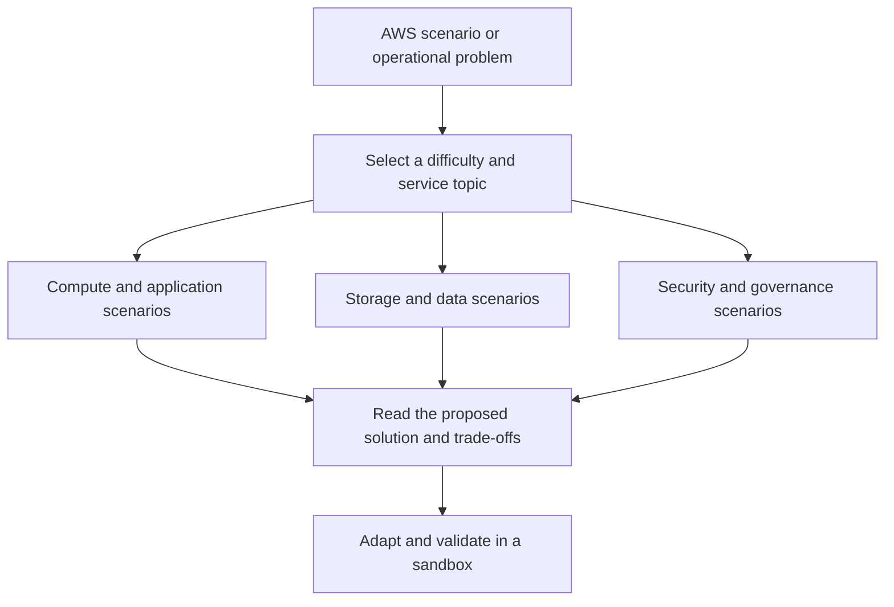

# AWS Real-Time Use Cases

A scenario-based AWS learning collection, forked from [miztiik/aws-real-time-use-cases](https://github.com/miztiik/aws-real-time-use-cases). Each folder describes a problem, service choices and an approach to solving it.

**Status:** This is a reference library of independent scenarios, rather than one deployable application.

## Learning and solution workflow

## Start here

Folder names use a difficulty level followed by a service or topic. Examples include [Lambda or Fargate](300-Lambda-Or-Fargate/README.md), [CloudFormation drift](300-CloudFormation-Drift-Detection/README.MD) and [Security Groups versus NACLs](100-Security-SecurityGroup-Vs-NACL/README.md).

[Previous README and detailed reference](https://github.com/mtzanida/aws-real-time-use-cases/blob/58677a496271629858deb400a6e65141c72be61e/README.md) are retained in Git history. They may describe older assumptions or unmerged plans; the scope above reflects this branch.
